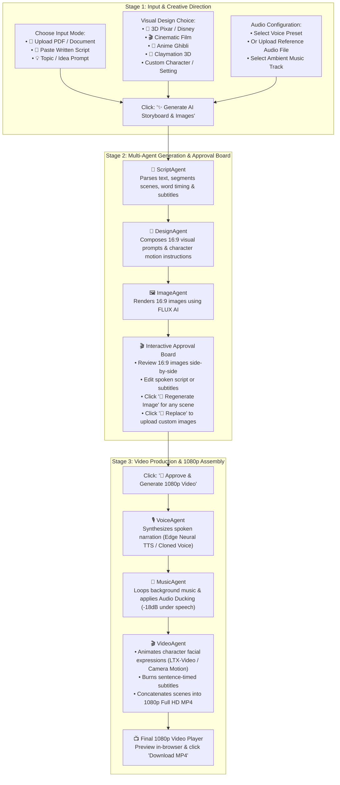

# AI Explainer Video Studio: Multi-Agent Production Architecture

A full-stack, automated AI Video Production Studio designed to transform raw ideas, pre-written scripts, or uploaded educational PDFs into finalized **1080p Full HD MP4 videos** complete with:
- Consistent 3D character visuals (Pixar, Anime, Cinematic, etc.)
- Expressive facial animations & eye blinking
- Natural neural voiceover narration
- Ducked background music (-18dB under speech)
- Sentence-synchronized burned subtitles
- An interactive **Approval & Review Board**

---

## 1. End-to-End System Flowchart



---

## 2. Multi-Agent Roster & Responsibilities

The system is architected around seven modular, single-responsibility agents located in [`backend/app/agents/`](file:///F:/Marison%20Files/Application/Video-Generation-Application/backend/app/agents/):

| Agent | Source File | Responsibilities |
| :--- | :--- | :--- |
| **ScriptAgent** | `script_agent.py` | Ingests PDF documents, lecture notes, pre-written scripts, or topic prompts, and segments them into timed educational scenes (~15–25s per scene, ~2.2 words/sec). Extracts titles, spoken narrations, and subtitles. |
| **DesignAgent** | `design_agent.py` | Applies visual art styles (3D Pixar, Anime, Cinematic, Claymation, etc.) and custom character/environment details. Injects uniform character anchors into all scene prompts to maintain character consistency across the video. |
| **ImageAgent** | `image_agent.py` | Renders high-resolution 16:9 widescreen visuals for each scene using Replicate FLUX.1-schnell, with an automatic resilient high-speed fallback. Saves images to `storage/uploads/` and handles per-scene regeneration. |
| **VoiceAgent** | `voice_agent.py` | Handles reference voice audio uploads, normalization to 24kHz mono WAV, real-time in-browser audio playback, and Edge Neural voiceover synthesis. |
| **MusicAgent** | `music_agent.py` | Curates royalty-free ambient music presets (Inspiring Educational, Gentle Lofi, Playful Curiosity) and calculates the FFmpeg audio ducking envelope (-18dB under speech). |
| **VideoAgent** | `video_agent.py` | Animates character facial expressions and eye movement using Replicate LTX-Video (or smooth 1080p Ken Burns camera motion), burns sentence-timed subtitles, and compiles the final MP4. |
| **DirectorAgent** | `director_agent.py` | Master orchestrator coordinating the sequential handoff from ScriptAgent to DesignAgent to ImageAgent, through the Approval Board, to the final rendering agents. |

---

## 3. Core Feature Details

### 3.1 Four Flexible Input Modes
1. **📄 Upload File (PDF, Word, Excel, CSV, Text)**:
   - Parses textbooks, lesson plans, syllabus files, Word documents (`.docx`), Excel spreadsheets (`.xlsx`), and tabular scene spreadsheets (`.csv`).
   - Automatically detects columns (Scene, Title, Script, Narration) and converts spreadsheet rows into storyboard scenes!
2. **🌐 Live Google Docs & Google Sheets Sync**:
   - Simply paste any shared Google Docs (`https://docs.google.com/document/d/...`) or Google Sheets (`https://docs.google.com/spreadsheets/d/...`) URL.
   - ScriptAgent automatically extracts live text and spreadsheet rows in real time!
3. **📝 Paste Written Script**:
   - Accepts raw text, lecture notes, or pre-formatted multi-scene scripts (`Scene 1: ...`, `Scene 2: ...`).
4. **💡 Topic / Idea Prompt**:
   - Generates an educational explainer from a simple topic prompt (e.g. *"Photosynthesis for grade 5"*).

### 3.2 Visual Design Customization
- **Pre-configured Art Styles**:
  - 🌟 **3D Pixar / Disney 3D**: Expressive animated characters, Octane render 8K, cinematic lighting.
  - 🎬 **Cinematic Realistic Film**: 35mm Arri Alexa photorealistic film photography.
  - 🎌 **Japanese Anime (Studio Ghibli)**: Hand-painted backgrounds, Makoto Shinkai lighting.
  - 🧸 **Claymation 3D**: Handcrafted tactile clay stop-motion textures.
  - 🖌️ **Vintage Watercolor Storybook**: Soft watercolor washes with delicate ink lines.
  - 🔮 **Futuristic Sci-Fi Cyberpunk**: Sleek holographic laboratory with volumetric lighting.
- **Custom Character & Setting Anchors**:
  - Users can define specific character names, clothing, hair, and facial traits, plus room/environment backdrops.
  - The `DesignAgent` embeds these visual anchors across every scene to guarantee character uniformity.

### 3.3 Reference Audio Upload & Instant Playback
- Upload any `.mp3`, `.wav`, or `.m4a` file.
- The `VoiceAgent` normalizes the file to 24kHz mono WAV.
- An embedded HTML5 audio player (`<audio controls src={...} />`) appears immediately in the UI to **play, listen to, and verify** the audio.
- The uploaded audio is automatically selected as the project's voiceover clone.

### 3.4 Interactive Approval Board
- The user reviews the AI-generated storyboard before rendering the final video.
- **Scene Cards**:
  - 16:9 Image Preview.
  - **"🔄 Regenerate Image"** button with inline prompt editor to re-roll visuals.
  - **"📁 Replace"** button to upload custom diagrams or images.
  - Editable spoken narration text and subtitles.
  - Editable character facial motion and expression prompts.
  - Scene timing and word count statistics.

### 3.5 Audio Ducking Engine
- Spoken narration is foregrounded at 100% volume.
- Background ambient music plays continuously underneath, automatically dropping by -18dB (volume ~0.12–0.14) whenever speech is active.
- Music smoothly swells during pauses, preventing narration from being drowned out.

### 3.6 1080p Full HD Video Production
- Final render combines:
  - 16:9 high-resolution imagery.
  - Character facial movement and blinking (Replicate LTX-Video) or cinematic camera motion.
  - Spoken narration synchronized with ducked ambient score.
  - Sentence-timed, high-legibility burned subtitles.
  - Output: Standalone **1920x1080 Full HD MP4**, downloadable with one click.

---

## 4. Project Directory Layout

```
Video-Generation-Application/
├── backend/
│   ├── app/
│   │   ├── agents/                     # Modular Agent System
│   │   │   ├── script_agent.py         # Script & Storyboard Agent
│   │   │   ├── design_agent.py         # Visual & Design Agent
│   │   │   ├── image_agent.py          # AI Image Generation Agent
│   │   │   ├── voice_agent.py          # Voice & Reference Audio Agent
│   │   │   ├── music_agent.py          # Music & Audio Ducking Agent
│   │   │   ├── video_agent.py          # Video Animation & Assembly Agent
│   │   │   └── director_agent.py       # Master Production Director
│   │   ├── core/
│   │   │   └── config.py               # Application settings & paths
│   │   ├── services/
│   │   │   ├── document_service.py     # PDF & text extraction
│   │   │   ├── replicate_service.py    # Replicate API client
│   │   │   ├── tts_service.py          # Edge Neural TTS synthesis
│   │   │   ├── video_service.py        # FFmpeg video operations
│   │   │   ├── music_service.py        # Music synthesis & ducking
│   │   │   └── pipeline_service.py     # Job registry & pipeline worker
│   │   └── main.py                     # FastAPI application & REST routes
│   ├── storage/
│   │   ├── uploads/                    # Generated images & uploaded audio
│   │   ├── music/                      # Ambient background score loops
│   │   └── project_input.json          # Storyboard state persistence
│   ├── requirements.txt                # Python backend dependencies
│   └── .env                            # Environment secrets & API tokens
├── frontend/
│   ├── src/
│   │   ├── components/
│   │   │   ├── Header.jsx              # Navigation & Replicate key status
│   │   │   ├── StudioInputSection.jsx  # Stage 1: Input Director & Design Picker
│   │   │   ├── ApprovalBoard.jsx       # Stage 2: Storyboard & Visuals Review Board
│   │   │   ├── ProductionMonitor.jsx   # Stage 3: Progress & 1080p Video Player
│   │   │   └── ReplicateApiKeyModal.jsx # API key configuration modal
│   │   ├── App.jsx                     # Top-level UI orchestration
│   │   └── index.css                   # Tailwind CSS styles
│   └── package.json                    # Frontend dependencies (React, Vite, Lucide)
└── outputs/                            # Final exported 1080p MP4 videos
```

---

## 5. Setup & Running Instructions

### Prerequisites
- Python 3.10+
- Node.js 18+
- FFmpeg (bundled automatically via `imageio-ffmpeg`)

### Step 1: Backend Setup
```powershell
cd "F:\Marison Files\Application\Video-Generation-Application\backend"

# Activate virtual environment
.\venv\Scripts\activate

# Install dependencies (if needed)
pip install -r requirements.txt

# Start FastAPI server
python -m uvicorn app.main:app --host 127.0.0.1 --port 8000 --reload
```

### Step 2: Frontend Setup
```powershell
cd "F:\Marison Files\Application\Video-Generation-Application\frontend"

# Start Vite development server
npm.cmd run dev
```

### Step 3: Access the Application
Open your web browser and navigate to:
```
http://localhost:5173
```

---

## 6. How to Use the Studio

1. **Step 1 — Input & Design**:
   - Select your input method: **Upload PDF**, **Paste Script**, or **Topic Prompt**.
   - Choose your **Visual Art Style** (e.g. *3D Pixar / Disney 3D*).
   - *(Optional)* Upload a **Reference Audio File** to use your own voice, and play it to verify.
   - Choose your background music preset.
   - Click **"✨ Generate AI Storyboard & Images"**.

2. **Step 2 — Approval Board**:
   - Review each scene's 16:9 visual image.
   - Edit the narration script or subtitles if needed.
   - Click **"🔄 Regenerate Image"** to re-roll any visual with an adjusted prompt.

3. **Step 3 — Render Video**:
   - Click **"🚀 Approve & Generate 1080p Video"**.
   - Watch live progress as the agents synthesize voiceover, duck music, animate facial motion, and assemble the video.
   - Play the final 1080p MP4 directly in the browser or click **"Download MP4"**.
